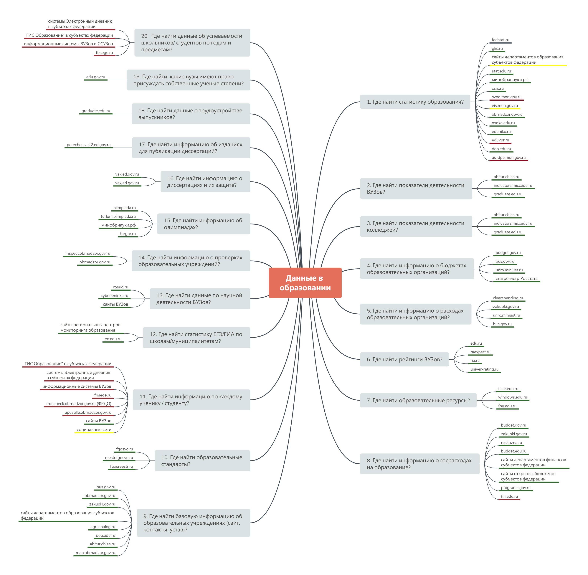

# Образование

## Описание

| Характеристиника | Значение |
| :--- | :--- |
| Предметная область | Образование |
| Последнее обновление | Декабрь 2018 г. |
| Источники сведений | ФГИС КИ, официальные сайты органов власти, экспертный анализ |
| Автор | Иван Бегтин \(ibegtin@infoculture.ru\) |

## Карта данных в формате интеллект карты 

## Карта данных для печати

## Файлы для скачивания





