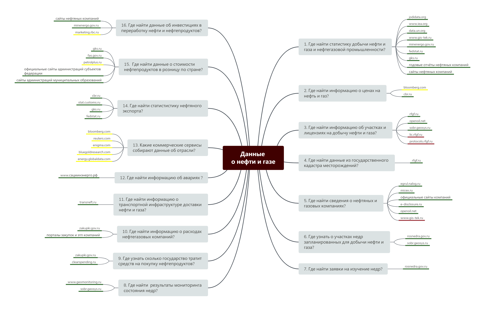

# Нефть и газ

## Описание

| Характеристиника | Значение |
| :--- | :--- |
| Предметная область | Нефть и газ |
| Последнее обновление | Декабрь 2019 г. |
| Источники сведений | официальные сайты профильных ФОИВ, оциаильные сайты нефтегазовых компаний, экспертный анализ |
| Автор | Иван Бегтин \(ibegtin@infoculture.ru\) |

## Карта данных в формате интеллект карты 

## Карта данных 

## Файлы для выгрузки





