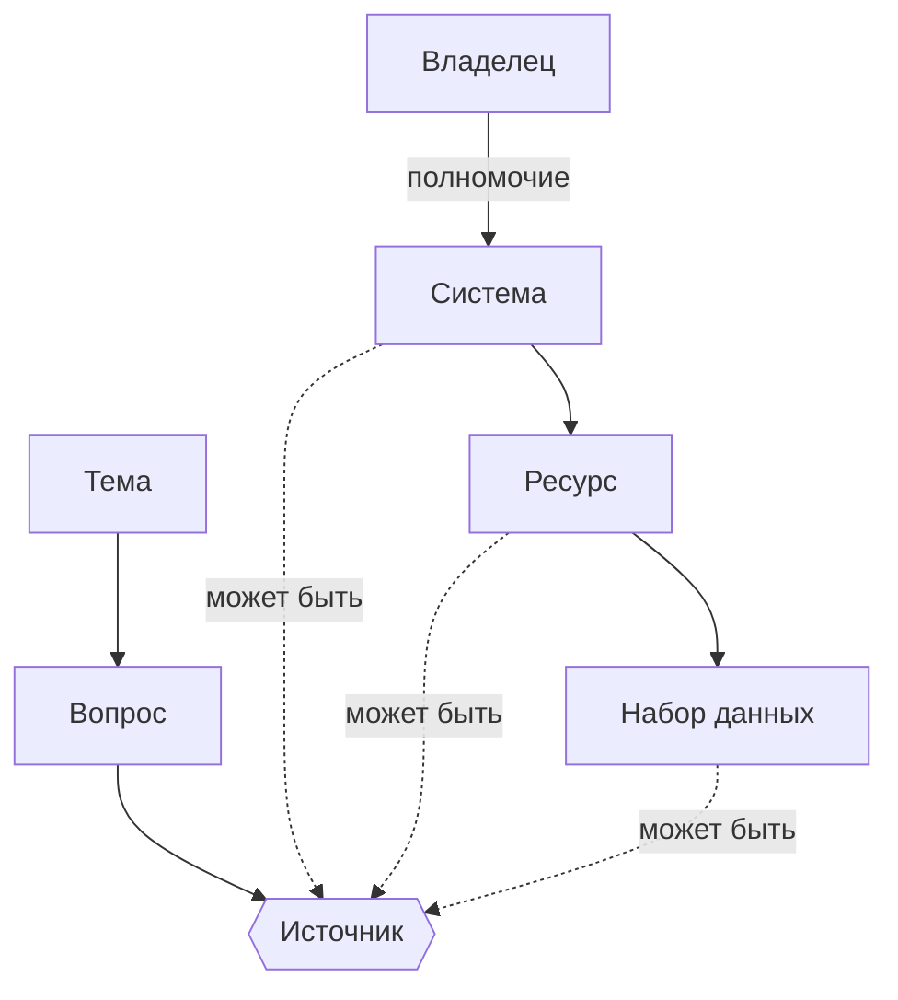

# Из чего состоит карта данных

Любая карта данных собрана из одних и тех же элементов: темы и вопросов, источников, их владельцев и статусов доступности. Виды карт различаются тем, какие элементы стоят в центре и какие можно пропустить. Обязательна для всех видов только дата проверки: без неё нельзя понять, насколько карте можно верить.

## Элементы

| Элемент | Что это | Пример |
|---------|---------|--------|
| **Тема** | Предметная область или территория, по которой составлена карта | Здравоохранение; транспорт в Республике Алтай |
| **Вопрос** | Что нужно узнать, в укрупнённом виде | Где узнать сведения по числу больниц в разрезе субъектов федерации? |
| **Продукт** | Что предполагается построить на данных, если карта строится от продукта, а не от вопросов | Единый реестр объектов законотворчества и нормативных правовых актов |
| **Владелец** | Орган власти или организация, которая ведёт систему и отвечает за данные | Росавиация |
| **Полномочие** | Обязанность владельца, ради которой создана система; закреплено в законе, постановлении или положении об органе власти | Обеспечение поисково-спасательных работ в гражданской авиации |
| **Система** | Информационная система: базы данных вместе с программами и оборудованием, которые их обрабатывают | ФГИС ИАС «Поиск» |
| **Ресурс** | Совокупность сведений внутри системы: реестр, база, перечень | Аэродромы дежурства поисково-спасательных воздушных судов |
| **Набор данных** | Опубликованная выгрузка ресурса: файл или программный интерфейс (API) | Набор открытых данных на портале ведомства |
| **Статус доступности** | Можно ли получить сведения и на каких условиях | Открытые данные; неструктурированные сведения; доступ с ограничениями; закрытая система; не установлено |
| **Дата проверки** | Когда сведения об источнике проверены в последний раз | Декабрь 2019 года |

Примеры системы и ресурса взяты из карты по Росавиации в главе [«Карта по полномочиям»](../02-map-types/04-authority-maps.md). Полномочие в таблице сформулировано по смыслу ресурсов этой системы и для настоящей карты должно быть взято из положения об органе власти.

## Как элементы связаны

Источником на карте может быть система, ресурс или набор данных — смотря насколько подробно удалось разобраться. Чем глубже, тем полезнее карта: «есть система у ведомства» говорит меньше, чем «в системе есть реестр, и он опубликован как набор открытых данных».

## Система, ресурс, набор данных и сайт

Эти четыре слова чаще всего путают при составлении карты.

- **Система** — программный комплекс с владельцем и основанием для создания. Государственная информационная система создаётся на основании закона или акта, перечисленного в статье 13 закона № 149-ФЗ, для реализации полномочий государственных органов (статья 14, см. [нормативную базу](../08-appendices/02-legal-framework.md)). С 1 сентября 2026 года государственные органы создают и «иные информационные системы», которые не являются государственными.
- **Ресурс** — то, что накоплено в системе. В одной системе может быть несколько ресурсов: у ФГИС ИАС «Поиск» на карте Росавиации их шесть.
- **Набор данных** — то, что из ресурса опубликовано. Бывает, что ресурс есть, а набора нет: тогда статус доступности у ресурса не «открытые данные».
- **Сайт** — не источник, а витрина. За сайтом стоит система, и на карту стоит записывать её. Если разобраться не удалось, сайт записывают как временную замену и отмечают это.

## Что обязательно для каждого вида карты

| Вид карты | Обязательные элементы |
|-----------|-----------------------|
| [От вопросов](../02-map-types/02-question-maps.md) | тема, вопросы, источники |
| [С предопределёнными темами](../02-map-types/03-predefined-themes.md) | тема, типовые темы, вопросы, источники |
| [По полномочиям](../02-map-types/04-authority-maps.md) | владелец, полномочия, системы, ресурсы |
| [От продукта](../02-map-types/05-product-maps.md) | продукт, системы, ресурсы, владельцы |
| [Доступности](../02-map-types/06-availability-maps.md) | владельцы, системы, статусы доступности |

Во всех видах — дата проверки. Статус доступности полезен на любой карте: в атласе он нанесён цветом поверх карты от вопросов.

## Источники

- Глава [«Как классифицировать карты данных»](../02-map-types/01-classification.md).
- Федеральный закон от 27.07.2006 № 149-ФЗ «Об информации, информационных технологиях и о защите информации», статья 2 — определение информационной системы, статья 13 — виды информационных систем, в том числе ГИС, статья 14 — цели создания ГИС; статьи 13 и 14 — в редакции закона № 568-ФЗ, действующей с 1 сентября 2026 года.
