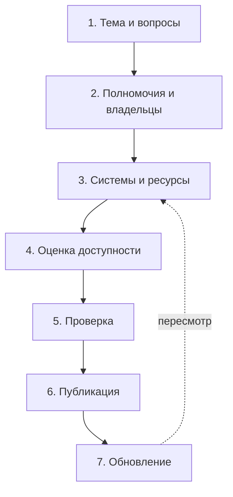

# Как составить карту: процесс

Карту составляют за семь шагов. Первые три дают черновик: вопросы и источники, которые на них отвечают. Следующие два делают черновик надёжным: у каждого источника появляются статус доступности, основание и дата проверки. Последние два превращают карту в то, чем могут пользоваться другие: её публикуют и регулярно обновляют.

Минимум, без которого карту не стоит показывать никому, кроме себя: вопросы, источники с владельцами, статусы доступности и дата проверки.

## Семь шагов

| Шаг | Что делают | Что получается | Глава |
|-----|------------|----------------|-------|
| 1. Тема и вопросы | Выбирают тему, проводят мозговой штурм, укрупняют вопросы | Список из 10–20 вопросов | [Выбор темы и подбор вопросов](./02-topic-and-questions.md) |
| 2. Полномочия и владельцы | Определяют органы власти и организации, отвечающие за тему, читают их полномочия | Список владельцев с полномочиями, которые порождают данные | [Привязка источников данных](./03-authorities-and-owners.md) |
| 3. Системы и ресурсы | Находят системы владельцев и ресурсы в них, привязывают к вопросам | Таблица источников, у каждого — вопросы, на которые он отвечает | [Описание системы и ресурса](./04-describing-systems.md), часть [«Где искать сведения о данных»](../04-sources/01-overview.md) |
| 4. Оценка доступности | Для каждого ресурса определяют, можно ли получить сведения и на каких условиях | Статус, основание и дата проверки у каждого источника | [Оценка доступности](./05-assessing-availability.md) |
| 5. Проверка | Самопроверка по списку, затем взгляд эксперта отрасли | Исправленная таблица, список того, что не удалось найти | [Проверка и публикация](./06-review-and-publish.md) |
| 6. Публикация | Рисуют карту, собирают паспорт и файлы | Карта, таблица, файл для печати | [Проверка и публикация](./06-review-and-publish.md) |
| 7. Обновление | Перепроверяют адреса, владельцев и статусы | Новая версия карты с датой и списком изменений | [Обновление карты](./07-maintenance.md) |

Шаги 2 и 3 часто идут вперемешку: найденная система подсказывает нового владельца, а полномочия нового владельца — новые системы. Это нормально. Важно, чтобы к шагу 4 у каждого источника был владелец.

## Таблица с первого дня

Карту ведут в таблице с самого начала, а картинку рисуют в конце. В таблице видно, у какого источника не хватает владельца или даты, её удобно сортировать и сравнивать с прошлой версией. Интеллект-карта хороша для мозгового штурма и для читателя, но плохо подходит для хранения сведений.

Минимальный набор колонок:

| Колонка | Пример |
|---------|--------|
| Вопрос | Где найти информацию об участках и лицензиях на добычу нефти и газа? |
| Источник | Название системы, ресурса или набора |
| Тип источника | система, ресурс, набор данных, сайт |
| Владелец | Орган власти или организация |
| Адрес | Ссылка, если есть |
| Статус доступности | открытые данные, неструктурированные сведения, с ограничениями, закрыто, не установлено |
| Основание статуса | Ссылка или документ, которые подтверждают статус |
| Дата проверки | Месяц и год |

Полный набор полей — в главе [«Описание системы и ресурса»](./04-describing-systems.md). Вопрос и источник связаны «многие ко многим»: один источник отвечает на несколько вопросов, на один вопрос отвечают несколько источников. Если это мешает, вопросы и источники ведут на двух листах, а связи — на третьем.

## Кто участвует

- **Составитель** ведёт таблицу и отвечает за то, чтобы у каждого источника были владелец, статус и дата.
- **Заказчик** — тот, кому карта нужна: руководитель, аналитик, команда продукта. Он даёт вопросы и подтверждает, что карта на них отвечает.
- **Эксперт отрасли** знает системы, о которых не пишут на сайтах. Его зовут на шаге 5, а иногда и на шаге 1.

Одному человеку можно совмещать все три роли, но тогда проверку на шаге 5 лучше отдать кому-то со стороны.

## От чего зависит трудоёмкость

- **Ширина темы.** «Транспорт в Республике Алтай» и «образование» различаются числом владельцев в разы.
- **Число уровней власти.** Федеральная тема проще, чем тема, где у каждого субъекта федерации своя система.
- **Глубина.** Карта до уровня систем собирается быстрее карты до уровня ресурсов, но и пользы от неё меньше.
- **Закрытость отрасли.** Чем меньше сведений публикуют сами владельцы, тем больше времени уходит на госзакупки, нормативные акты и экспертов.

## Типичные ошибки на старте

- Начинать со списка известных систем, а не с вопросов: карта получается про то, что составитель уже знает.
- Рисовать сразу картинку: через неделю в ней невозможно найти источник без даты.
- Не записывать, откуда взято сведение: при проверке приходится искать заново.

## Источники

- Глава [«Из чего состоит карта данных»](../01-basics/03-anatomy.md) — элементы карты.
- Глава [«Как классифицировать карты данных»](../02-map-types/01-classification.md) — виды карт и с чего строить карту под задачу.
