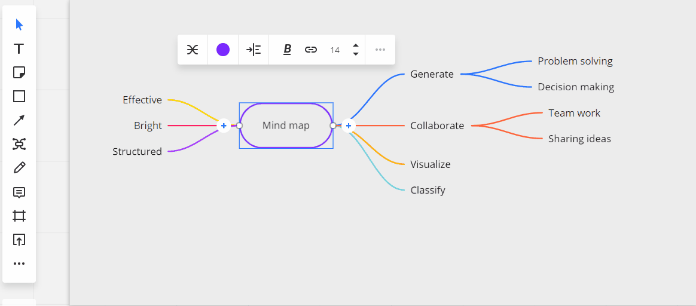
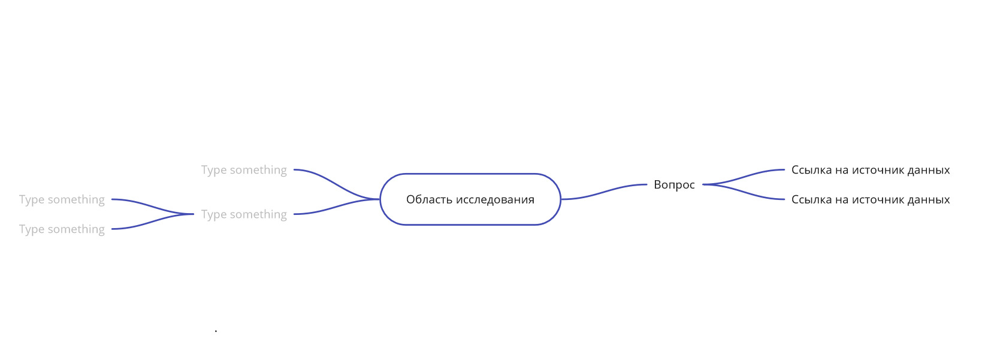
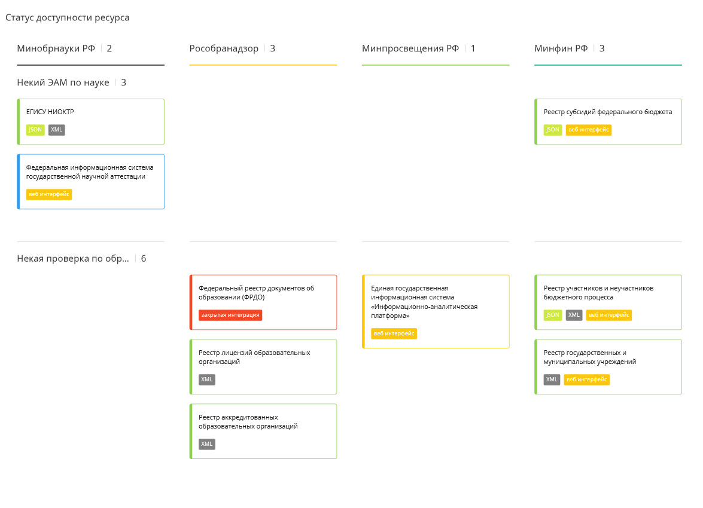

# Что такое карты данных?

## Зачем нужны и как рисовать карты данных?

В зависимости от решаемых задач, построения систем поддержки принятия решений или продуктов основанных на данных для решения конкретных задач, создаются списки доступных данных и проектируется ИТ архитектура их интеграции.

Карта данных позволяет выявить пробелы в и определить возможности интеграции данных. Карта может быть построена на одном из нескольких принципов:

* карты данных основанные на ответах на вопросы;
* карты данных, основанные на полномочиях и государственных системах в иерархии: ведомство -&gt; полномочия -&gt; ГИС -&gt; реестры данных
* карты данных, основанные на итоговом продукте, который предполагается создавать с использованием данных
* карты данных, основанные на доступности данных. При этом карта не даёт полной картины данных, для которых также важны характеристики их интегрируемости, возможности связывать с другими источниками информации, актуальность и многие другие аспекты.

## Что такое интеллект-карты

Интеллект карты - это общепринятый распространённый способ структуризации данных как при индивидуальной работе, так и в при коллективном проектировании и мозговых штурмах. Они обеспечивают высокую гибкость описания предметной области и, одновременно, возможность структуризации понятий по простым и понятным шаблонам. 

Наиболее простые карты данных создаются через визуализацию в виде интеллект-карт \(mindmap\). Это структурированная визуализация смысловых понятий объединённых иерархическими связями от центрального понятия/основного узла.

Две наиболее простых модели создания карт данных построены на интеллект-картах.

Существует множество инструментов создания интеллект-карт, в этом руководстве примеры будут приведены для настольного приложения [Xmind](https://xmind.net)  и онлайн сервиса [Miro](https://www.miro.com).

## Виды карт данных

### Базовая карта данных \(тема - вопросы - источники данных\)

Базовая карта данных состоит из серии вопросов привязанных к определённой отрасли \(области исследований\). Вопросы формируются в свободном стиле и, как правило, они звучат как "Где найти ... ?". К каждому вопросу привязываются источники данных которые могут дублироваться в случаях когда от вопросов

### Предопределённые темы

Карта данных с предопределёнными темами - это 4-х ступенчатая карта данных где между вопросами и областью знаний находятся типовые группы вопросов повторяющихся от отрасли к отрасли. 

Типовые темы это:

* Статистика - различные статистические показатели
* Организации - сведения о юридических лицах
* Финансы - сведения о финансах организций, бюджетах, контрактах и так далее
* Люди - сведения о физических лицах
* Ресурсы - сведения о иных информационных ресурсах/объектах.

### Владельцы, системы, ресурсы, задачи

Моделирование владельцев, систем, ресурсов и задач необходимо для визуализации необходимых и достаточных источников данных. В центр карты помещаются продукты/результаты которые предполагается создать на их основе, каждая система и информационные ресурсы в них описываются с точки зрения их использования с конечными продуктами. 

### Статус доступности системы или ресурса

Статус доступности системы/ресурса - это карта данных отрисовываемая в стиле визуализации Kanban, с карточками для каждой системы организованными в виде списков в столбцах где каждый столбец - это орган власти. 

Доступность данных определяется цветовой рамкой карточки источника данных.

Используется следующая цветовая классификация:

* зелёный цвет - доступны открытые данные
* синий цвет - сведения доступны, но  в неструктурированных форматах
* жёлтый цвет - сведения доступны с ограничениями/требуют авторизации
* красный цвет - система является закрытой и есть юридические ограничения

